<div align="center">

# 奥丁的盛宴小助手

**跟着流程走，计分不费神**

《奥丁的盛宴》（A Feast for Odin）线下对局的多人同步工具：轮次流程提示、起始玩家、终局计分、结算长图一站搞定。

一桌人用手机扫码进同一个房间，所有操作实时同步，无需下载、无需注册。

**[立即使用 → odin.leisurecat.cloud](https://odin.leisurecat.cloud)**

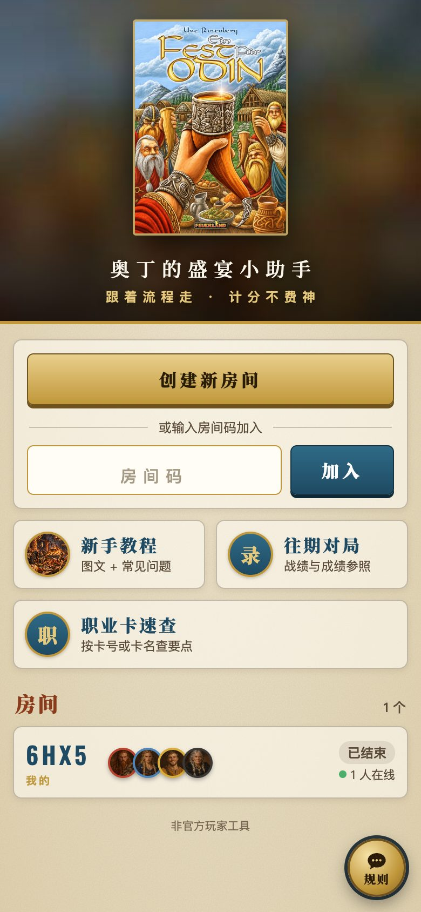

</div>

---

## 功能一览

### 开局：人数、游戏长度、座位与颜色

1–4 人局，标准模式 7 轮或快速模式 6 轮。每位玩家填名字、选颜色（红、蓝、黄、黑），按顺时针排好座位。可以手动指定起始玩家，或点「随机抽起始玩家」，所有手机同时播放抽签动画（规则书：起始玩家随机决定）。单人游戏自动跳过起始玩家相关的步骤。

两个规则选项：
- **挪威扩展**：流程提示（同字母探索版图一起翻、第 5 列、马和猪的繁殖）和计分表（马、猪、胜利点标记、手工工棚）跟着变，依据 Feuerland 德文规则书。
- **停手顺序轮序**（3 人以上）：扩展设计师推荐、《丹麦人》的正式规则。行动阶段按先后点停手的人，下一轮自动排成「最后停手的先手，越早停手越靠后」。

<p>
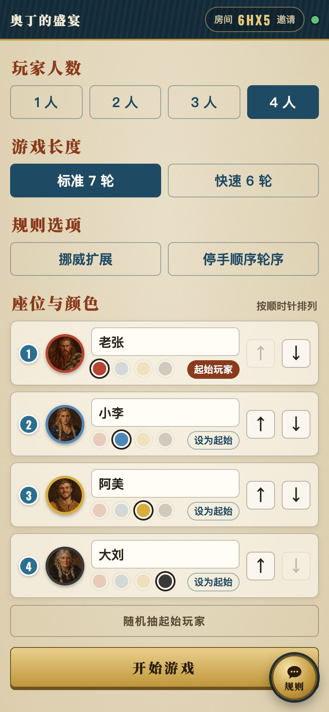
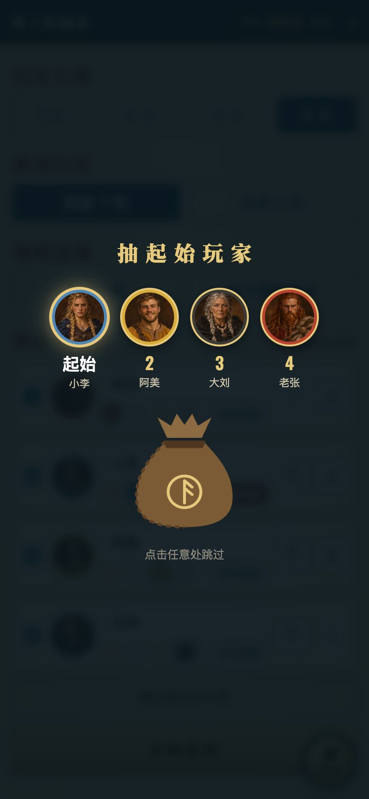
</p>

### 对局：12 个阶段逐个提示

「流程」页显示当前是第几轮、第几阶段，以及这一阶段每人要做什么（阶段名用中文版用词）：增加维京人、收获（本轮拿哪些作物）、翻转探索版图（哪块翻成哪块、其余各放 2 银币）、抽取武器卡、行动、决定起始玩家、收入、动物繁殖、宴会、奖励、山脉板块、取回维京人。本轮没有的阶段会划掉并写明原因（例如第 1 轮和最后一轮不翻探索版图；最后一轮宴会后直接结束）。

在「决定起始玩家」阶段点选最后放置维京人的玩家，下一轮的行动顺序自动从他开始顺时针排列。点错了可以一步步撤销，断线重连自动追上进度。

<p>
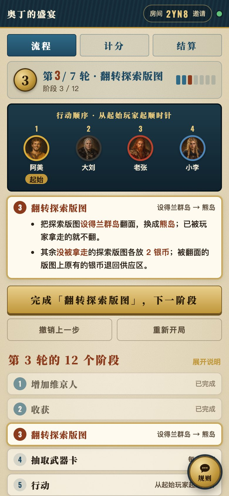
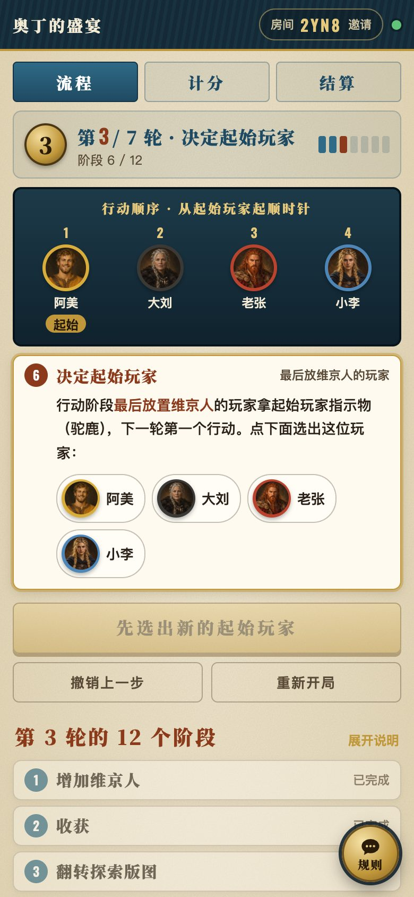
</p>

### 计分：每人在自己手机上填，带防错提示

「我的计分」：每人选好自己是谁，只填自己那一列，各项旁边写清怎么算；键盘有「捕鲸船 3 / 商船 5 / 长船 8」「羊 2 / 怀孕羊 3 …」这类快捷按钮；填了不可能的分值（比如船填 4）会标出来，填了最终收入会提醒别和银币重复计分。这些防错点来自社区调研：BGG 上最常见的计分错误就是最终收入和银币重复计算、船只和移民重复计算。

<p>
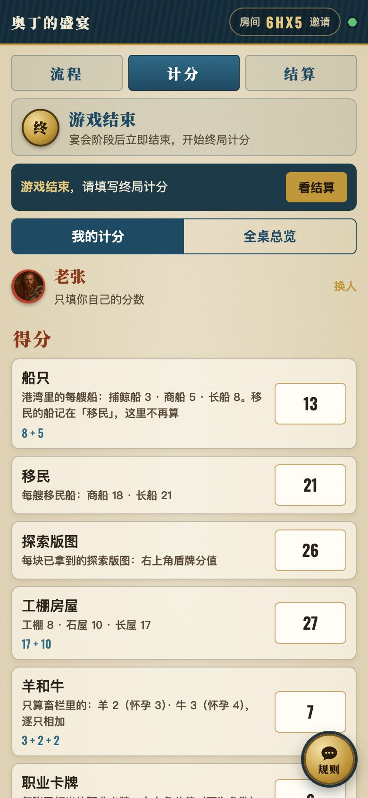
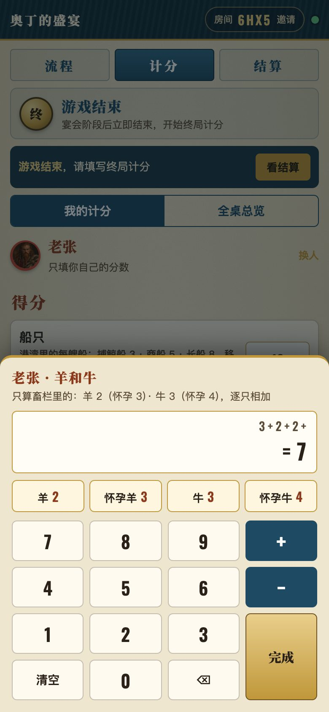
</p>

「全桌总览」：一张竖向计分表，一列一位玩家，没手机的玩家可以由别人代填。加分：船只、移民、探索版图、房屋、牛羊、职业卡、银币、最终收入、英格兰王冠；扣分：部落版图、探索版图、房屋上的负分格和庭之惩罚（每张 −3）。船只、探索版图等逐项输入算式（如 3+5+8），扣分项填正数，合计实时更新。英格兰王冠只有一块，点给谁就从别人那里移走。

<p>
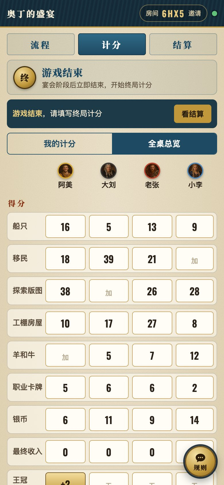
</p>

### 结算：MVP、得分构成、成就，一键存长图

自动算出排名（同分按规则书并列获胜），展示 MVP、每人得分构成（航海 / 探索 / 房屋 / 牛羊 / 职业 / 财富，另列扣分）和 10 种趣味成就。终局时仍可修改玩家名，一键把整页结算生成长图，长按保存到相册。

结算页最下面还有「给这款游戏打个分」：选好自己是谁（默认带出计分页选过的玩家），打 1–5 星、写一句评论，提交到[桌游小助手首页](https://boardgame.leisurecat.cloud)的统一评价接口，计入这款游戏的整体评分。评价卡不进长图；同一局再次提交会覆盖之前的评价。

<p>
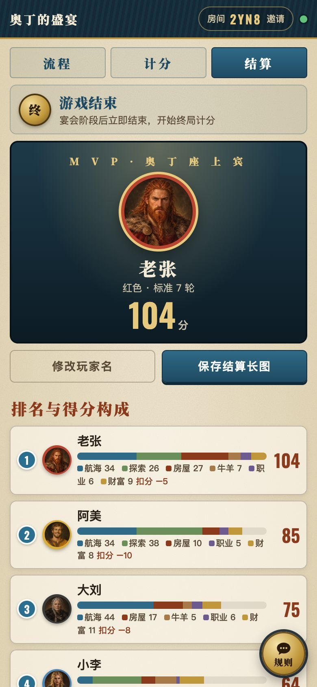
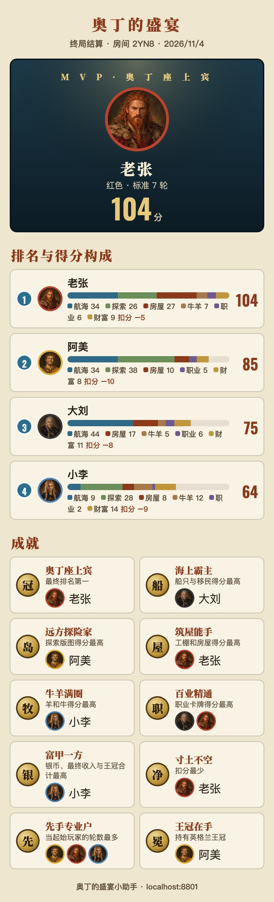
</p>

### 往期对局

每局结束自动存档，可按玩家名、颜色或房间码搜索，展开查看每人的得分明细。上方的「成绩参照」按人数 × 局长（× 是否挪威扩展）列出平均分、冠军平均分和最高分；搜索玩家名时再列出这个人的最高分和平均分。

<p>
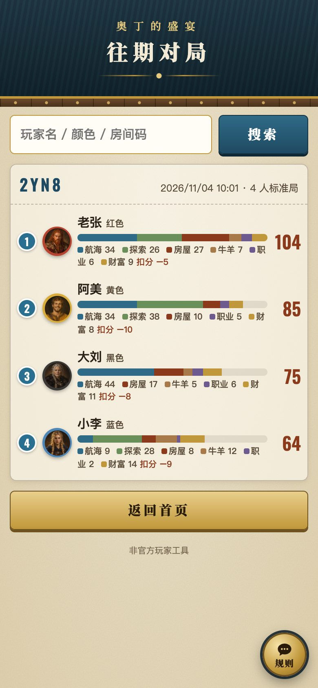
</p>

### 职业卡速查

按卡号（39 或 39C）或卡名查 190 张职业卡：中英文卡名、类别、分值、一句话要点、官方澄清，并标出挪威扩展下禁用的 8 张。要点是本站用自己的话概括的，不收录卡面原文；数据核对了英文、德文、中文三种附录。

<p>
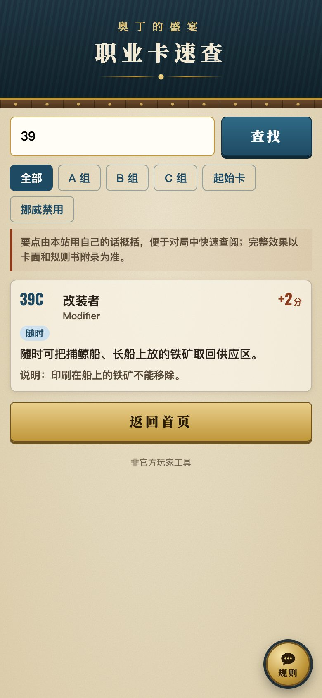
</p>

### 新手教程与常见问题

18 节图文讲解（含挪威扩展和停手顺序轮序），加上依据官方规则书整理的 32 条常见问题，新手开局前刷一遍就能上桌。

<p>
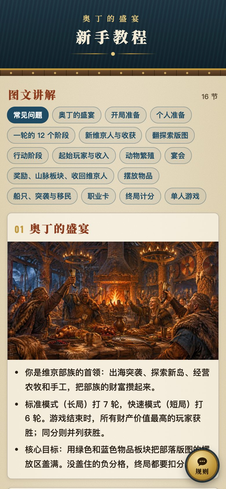

</p>

### 规则助手

每个页面右下角都有「规则」按钮，点开就能用中文问规则，比如宴会桌上的食物怎么摆、牛羊怎么繁殖。助手用 DeepSeek V4.1 Flash（`deepseek-flash`）逐字回答，只依据本站的讲解稿和常见问题作答，资料里没有的不会乱编。Flash 过载、排队或出错时，依次改由备用模型回答（页面上不显示是哪个模型，服务端日志里有记录）：先是 Cloudflare Workers AI 上的 Qwen3.8 27B（`@cf/qwen/qwen3.8-27b`，不依赖 DeepSeek 的服务器），再是 DeepSeek V4 Pro（`deepseek-v4-pro`）。每个模型 9 秒内须开始回答，回答中途停顿超过 8 秒也会换下一个模型从头回答；都不行就提示稍后再问。另有每小时一次的定时检查（Cron Trigger）：DeepSeek 不通时，接下来一小时直接先用 Qwen，结果存在 KV 里。

<p>
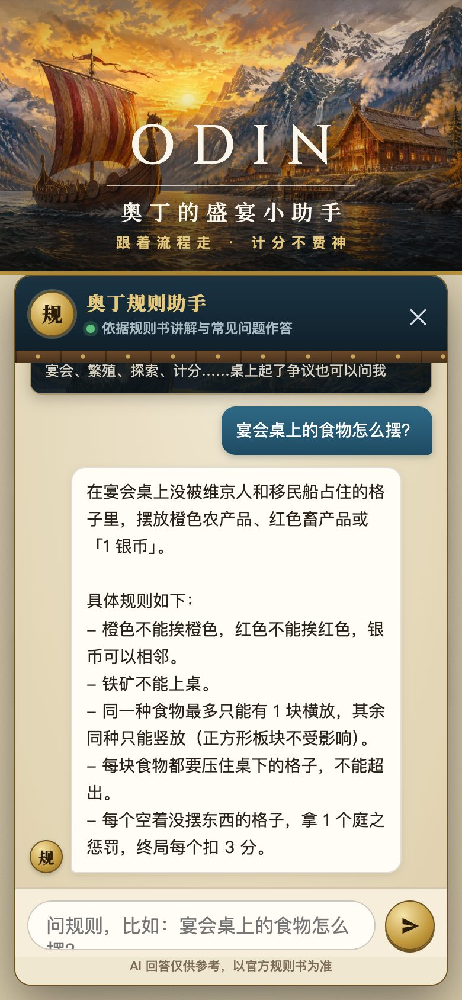
</p>

---

## 技术实现

纯前端页面 + Cloudflare Workers，没有构建步骤，没有框架。结构与姊妹项目[匹兹堡开局小助手](https://github.com/86777835/brass-pittsburgh-helper)一致。

| 部分 | 说明 |
|---|---|
| `public/` | 页面静态资源：`index.html`、`app.js`、`style.css`、`img/`、教程页 `guide.html`、往期对局 `history.html` |
| `public/logic.js` | 规则与状态逻辑（12 个阶段、起始玩家、计分、成就），页面和服务端共用同一份代码，服务端权威校验 |
| `public/phases.js` | 每个阶段在每一轮的提示文字（含挪威扩展和停手顺序轮序） |
| `public/cards.json` | 职业卡速查数据（本站概括的要点，非卡面原文） |
| `src/worker.js` | Cloudflare Worker：建房接口；`Room`（每个房间一个 Durable Object，WebSocket 实时同步）；`Lobby`（首页房间列表）；`Archive`（往期对局存档）；`/api/chat` 规则助手（DeepSeek 流式转发，按 IP 限流，密钥只存在服务端） |
| `public/vendor/` | [html2canvas](https://github.com/niklasvh/html2canvas) 1.4.1（MIT），用于生成结算长图 |
| `tools/` | 教程页生成脚本、讲解稿与常见问题数据、README 截图脚本 |
| `tests/` | Playwright 多手机端到端测试 |

## 本地开发与部署

需要 Node.js 和 [Wrangler](https://developers.cloudflare.com/workers/wrangler/)。

```bash
wrangler dev --port 8801     # 本地运行，打开 http://localhost:8801
wrangler deploy              # 部署到你自己的 Cloudflare 账号
```

自己部署时：
- **域名**：去掉或改掉 `wrangler.jsonc` 里的自定义域名 `odin.leisurecat.cloud`，以及 `public/index.html`、`tools/build_guide.py` 里分享图的地址。
- **KV**：`CHAT_STATE` 没写 id，首次 `wrangler deploy` 时会自动创建。
- **规则助手**（可选）：运行 `wrangler secret put DEEPSEEK_API_KEY` 填入你的 DeepSeek API 密钥；不配置时助手会提示「还没有配置好」。

重新生成教程页：

```bash
python3 tools/build_guide.py tools/讲解稿.md public/guide.html tools/faq.json
```

## 测试

需要本机安装 Chrome，以及 `npm i playwright-core`。

```bash
node tests/test_room.mjs    http://localhost:8801/ ./shots                # 双手机打完整 3 人长局（7 轮 × 12 阶段）并计分
node tests/test_room2.mjs   http://localhost:8801/ ./shots                # 4 人局、小屏、撤销、断线、无效分数、平分、改名、长图、短局、单人
node tests/test_history.mjs http://localhost:8801/ ./shots --many-rooms   # 往期对局存档与搜索；房间多时首页按钮仍在首屏
node tests/test_history.mjs https://你的域名/ ./shots --live              # 线上冒烟：打完一局再撤销，不留记录
node tests/test_review.mjs  http://localhost:8801/ ./shots                # 结算页评价卡（总入口接口用 page.route 拦截，不往线上写数据）
node tests/test_chat.mjs    http://localhost:8801/ ./shots --no-key       # 规则助手界面（未配置密钥时）
node tests/test_chat.mjs    http://localhost:8801/ ./shots --mock-upstream # 备用模型切换（wrangler dev 需加 --var DEEPSEEK_API_KEY:fake --var DEEPSEEK_BASE:http://127.0.0.1:8790 --var CHAT_CF_MODEL:@cf/none/missing）
node tests/test_chat.mjs    https://你的域名/ ./shots --live              # 规则助手线上实问一次
node tools/screenshots.mjs  http://localhost:8801/ docs/screenshots       # 重新生成 README 截图（需空的本地数据）
```

打完整局的测试会在往期对局里留下记录，所以请对本地 `wrangler dev` 运行；线上只跑 `--live`。

## 声明

- 本项目是非官方的玩家工具，不提供游戏本体，也不能在线玩这个游戏。线下对局仍需实体《奥丁的盛宴》。
- 规则依据 Z-Man Games 英文版官方规则书（山脉板块按 Feuerland 官方勘误：最后的「2 银币」也算一项），术语采用游人码头中文版用词。常见问题由规则书整理，并非官方 FAQ。
- 规则整理与每条出处见 [docs/规则整理.md](docs/规则整理.md)；挪威扩展部分依据 [Feuerland 德文规则书](https://www.feuerland-spiele.de/fileadmin/game/Ein_Fest_fuer_Odin/Exp_1_Die_Norweger/Regelbuch.pdf)。
- 快速模式（6 轮）各轮的收获，规则书没有印出，是根据部落版图快速模式那一面的照片整理的；玩家颜色（红、蓝、黄、黑）也来自实物照片。
- 游戏名称和规则的权利归原出版方（Feuerland Spiele / Z-Man Games）所有。首页展示的是 Feuerland 版《Ein Fest für Odin》原版封面（用 Codex CLI 高清化），版权归出版方；头像、教程插图和图标是用 Codex CLI 生成的原创插画。
- 代码以 [MIT](LICENSE) 许可开源。
